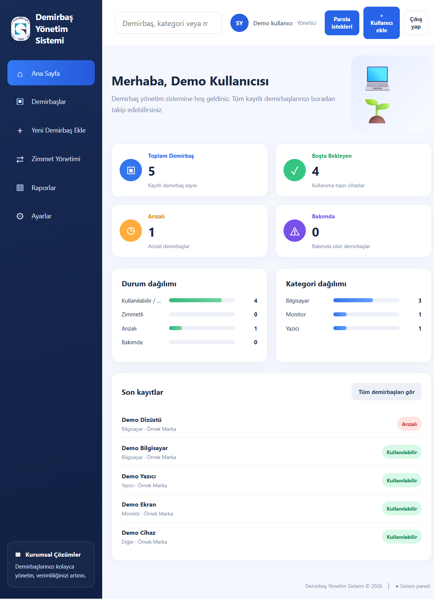
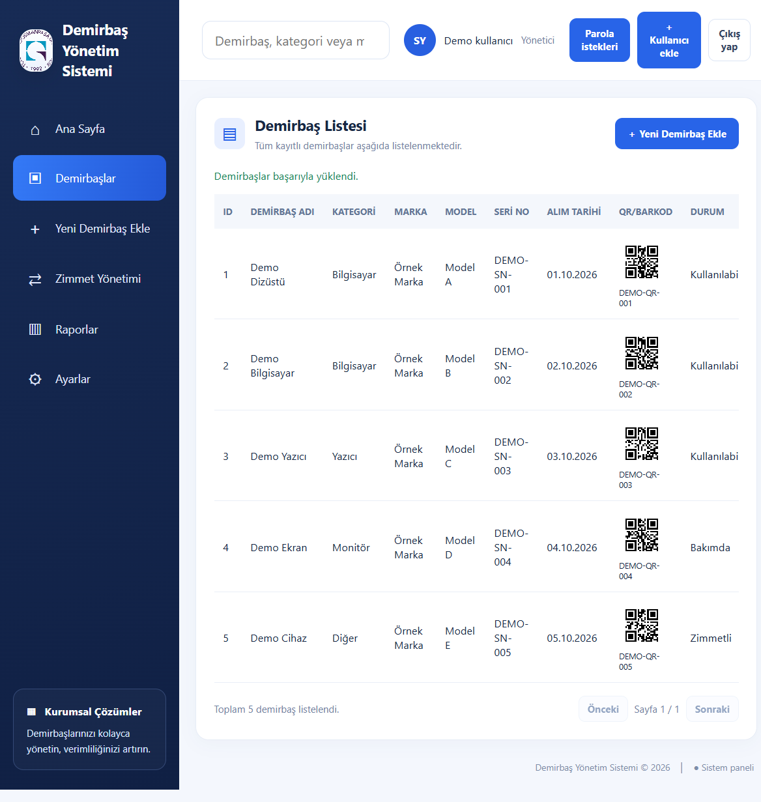
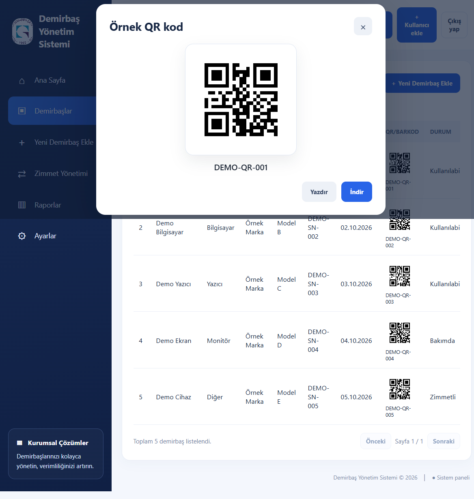
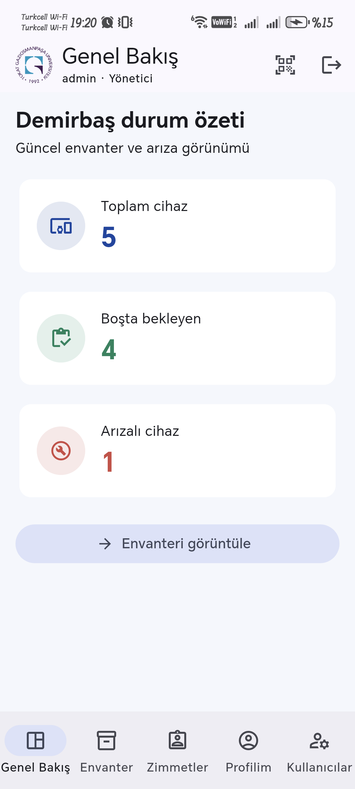

# Demirbaş Yönetim Sistemi

Demirbaş Yönetim Sistemi; kurum envanterini web ve Flutter mobil uygulamasından takip etmeyi, QR/barkod ile cihaz bulmayı ve zimmet süreçlerini yönetmeyi sağlayan bir uygulamadır.

## Ekran görüntüleri

Görsellerde yalnızca örnek envanter verileri kullanılmıştır.

| Web dashboard | Demirbaş listesi | Örnek QR kod |
| --- | --- | --- |
|  |  |  |

| Mobil uygulama |
| --- |
|  |

## Özellikler

- Web dashboard: envanter toplamları, durum ve kategori dağılımları, son kayıtlar.
- Demirbaş arama, listeleme, sayfalama ve yönetici işlemleri.
- Standart QR kod üretme, QR indirme/yazdırma ve kodla envanter kaydı bulma.
- Kullanıcı ve yönetici oturumu.
- Zimmet, iade, personel ve departman iş akışları.
- Flutter mobil istemcisinde envanter, QR/barkod tarama, galeriden kod okuma ve zimmet işlemleri.

## Gereksinimler

Yerel web geliştirme için:

- .NET 10 SDK
- SQL Server / SQL Server Express
- Git

Mobil geliştirme için ayrıca Flutter SDK (projenin Dart SDK kısıtına uygun), Android Studio/Android SDK ve gerektiğinde Xcode gerekir.

Docker ile çalıştırmak için:

- Docker Desktop veya Docker Engine
- Docker Compose v2
- SQL Server Developer Edition container'ını çalıştırabilecek x86-64 ortam

## Yapılandırma

Uygulama yapılandırması ASP.NET Core ortam değişkenleriyle verilebilir. `:` ayıracı yerine çift alt çizgi kullanılır:

| Değişken | Açıklama |
| --- | --- |
| `ConnectionStrings__DefaultConnection` | SQL Server bağlantı dizesi |
| `AppSettings__DefaultAdminUser` | İlk açılışta oluşturulacak yönetici adı |
| `AppSettings__DefaultAdminPassword` | İlk açılışta oluşturulacak yönetici parolası; en az 12 karakter |

Yönetici bilgileri kaynak kodda varsayılan parola olarak tutulmaz. Mevcut yönetici hesabı varsa uygulama onu yönetici rolünde tutar; parola değiştirmek için uygulamanın parola yönetimini kullanın. Parolaları Git deposuna veya ekran görüntülerine koymayın.

## Web uygulamasını yerel çalıştırma

1. SQL Server'ı başlatın ve `appsettings.json` içindeki yerel `DefaultConnection` değerinin kendi SQL Server kurulumunuza uyduğunu kontrol edin. Alternatif olarak bağlantıyı ortam değişkeniyle geçersiz kılın.
2. PowerShell'de proje kökünden gerekli değişkenleri ayarlayıp uygulamayı başlatın:

   ```powershell
   $env:ConnectionStrings__DefaultConnection = 'Server=.\SQLEXpress;Database=DemirbasYonetimProjeDB;Trusted_Connection=True;TrustServerCertificate=True;'
   $env:AppSettings__DefaultAdminUser = 'admin'
   $env:AppSettings__DefaultAdminPassword = Read-Host 'En az 12 karakterli yönetici parolası'
   dotnet run --launch-profile http
   ```

3. Tarayıcıda <http://localhost:5181/> adresini açın. `frontend/index.html` dosyasını doğrudan `file://` ile açmayın; uygulama web sunucusu üzerinden çalışmalıdır.

API bağlantısı <http://localhost:5181/api> adresindedir. Geliştirme ortamında OpenAPI belgesi <http://localhost:5181/openapi/v1.json> adresinde sunulur.

## Mobil uygulamayı çalıştırma

Önce API'yi <http://localhost:5181/> adresinde çalışır durumda tutun. Sonra:

```powershell
cd mobil
flutter pub get
flutter run
```

Android emülatöründeki varsayılan API adresi `10.0.2.2:5181`'dir. USB ile bağlı Android telefonda yerel API'ye erişmek için:

```powershell
adb reverse tcp:5181 tcp:5181
flutter run --device-id <ANDROID_DEVICE_ID> --dart-define=API_BASE_URL=http://127.0.0.1:5181/api
```

`adb reverse` yalnızca USB hata ayıklama bağlantısında kullanılabilir. Release uygulaması HTTPS gerektirir; HTTP izni debug derlemesiyle sınırlıdır. Ayrıntılar için [mobil/README.md](mobil/README.md) dosyasına bakın.

## Test ve doğrulama

Backend'i derlemek için:

```powershell
dotnet build
```

Mobil analiz ve widget testleri için:

```powershell
cd mobil
flutter analyze
flutter test
```

## Docker Compose ile çalıştırma

Compose kurulumu yerel deneme içindir; veritabanı kalıcılığını volume ile sağlar ve uygulama başlamadan önce SQL Server'ı hazırlar.

1. Proje kökünde `.env.example` dosyasını `.env` olarak kopyalayın:

   ```powershell
   Copy-Item .env.example .env
   ```

2. `.env` içindeki SQL ve uygulama yönetici parolalarını **birbirinden farklı, güçlü değerlerle** değiştirin. `.env` Git tarafından yok sayılır; `.env.example` içindeki örnek değerlerle gerçek kullanımda başlatmayın.
3. Başlatın:

   ```powershell
   docker compose up --build
   ```

4. <http://localhost:5181/> adresini açın. Arka planda `sqlserver` servisi, `sqlserver-data` kalıcı volume'u ve web uygulaması çalışır.

Durdurmak için `Ctrl+C`, arka planda başlatılmış servisleri durdurmak için:

```powershell
docker compose down
```

Verileri de silerek sıfırdan kurmak için `docker compose down -v` kullanılabilir. Bu komut SQL Server volume'undaki verileri kalıcı olarak siler; yalnızca gerçekten sıfırlamak istediğinizde çalıştırın.

Bu Compose tanımı TLS/reverse proxy, üretim sır yönetimi, yedekleme veya internete açık dağıtım sağlamaz. Üretim ortamında HTTPS, ayrı ve en az yetkili SQL hesabı, güvenli secret yönetimi ve yedekleme yapılandırılmalıdır. SQL Server Developer Edition yalnızca geliştirme/test içindir.

## Depoda paylaşım

1. Ekran görüntülerini `docs/screenshots/` altında tutun; kişi/kurum açısından hassas bilgi ve gerçek kimlik bilgileri içermediğini doğrulayın.
2. `.gitignore` derleme çıktıları, yerel loglar, `.env` ve Flutter build çıktılarını dışarıda bırakır. İlk push'tan önce `git status` ve `git diff --cached` ile paylaşılacak dosyaları kontrol edin.
3. GitHub veya GitLab'da boş bir **public** repository oluşturup talimatlarındaki uzak adresi `origin` olarak ekleyin, `main` dalını push edin. Bu yerel klasörde henüz Git deposu/uzak repo bulunmadığından bu adım hesapta repository oluşturma erişimi gerektirir.


